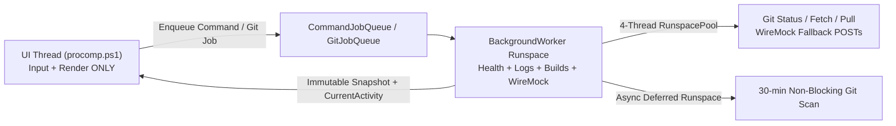

# `procomp` Architecture

`procomp` (Process Composer) is a lightweight, zero-dependency, language-agnostic PowerShell TUI and process orchestrator for running, monitoring, and routing local microservices (Spring Boot, Quarkus, Node.js, ActiveMQ, WireMock, custom test runners, etc.) on Windows.

It is compatible with both **Windows PowerShell 5.1+** and **PowerShell 7+**, requiring no external binaries or compilation step.

> For the complete language-agnostic behavioral specification (suitable for porting to pure Bash, Go, Rust, or Python), see **[SPEC.md](SPEC.md)**.
> For numbered Architecture Decision Records, see **[ADR.md](ADR.md)**.

---

## 1. Module Map

| File | Responsibility |
| :--- | :--- |
| `procomp.ps1` / `procomp.cmd` | CLI (`tui`, `up`, `down`, `status`, `sync`, `fetch`, `clone`, `build`, `doctor`) & non-blocking TUI event loop. |
| `src/Config.ps1` | UTF-8/BOM-safe `procomp.json` + `appsFile` loader, `defaults` & `gateway` synthesis, template expansion, `Invoke-ParallelWork` (4-thread `RunspacePool`), and `debug`/`trace` logging. |
| `src/EnvLoader.ps1` | Layered `.env` < `defaults.env` < `runtime.env` < `app.env` < `.env.<servicename>` environment merging. |
| `src/BuildRunner.ps1` | Async/sync builder execution, thread-safe non-interactive Git (`ProcessStartInfo`), 4-thread `Refresh-GitSummaries`, and `PROCOMP_MOCK_GIT_DELAY_MS` simulation. |
| `src/IdeDetector.ps1` | `< 1 ms` `IPGlobalProperties` TCP listener fast-path + `Get-NetTCPConnection` + `Win32_Process` parent-PID walk (`IDE-UP` / `PORT-CONFLICT`). |
| `src/ProcessManager.ps1` | Direct 1:1 process execution, relative executable resolution in `WorkingDirectory`, `-AsyncBuild`, external WireMock reuse, and `taskkill.exe /F /T /PID` teardown. |
| `src/HealthMonitor.ps1` | `LOCAL`-only non-blocking `HttpClient.GetAsync()` polling (1.5s while `STARTING`/`IDE-INIT`, 10s once `HEALTHY`/`IDE-UP`). |
| `src/WireMockBridge.ps1` | Fast localhost TCP pre-check, `DELETE` + batch `POST /__admin/mappings/import` sync, single-route `PUT`/`POST` toggle, drift check, and Journal/Mappings viewer formatting. |
| `src/LogViewer.ps1` | Incremental byte-offset reader, 1000-entry ring buffer, fast JSON UTC→local normalization, stack-trace folding, and timestamp-less `SortKey` inheritance. |
| `src/BackgroundWorker.ps1` | Dedicated background `[Runspace]` owning `CommandJobQueue`, `GitJobQueue`, async `BuildProc` polling, deferred 30-min async Git checks, `stderr` smart placement, and live `CurrentActivity` ticker updates. |
| `src/ConsoleInput.ps1` | Win32 `kernel32.dll` (`ReadConsoleInputW`) unified keyboard + mouse input. |
| `src/Tui.ps1` | ANSI Alternate Screen Buffer renderer for all 4 peer views (`1` Services, `2` Logs, `3` WireMock, `4` Procomp) with adaptive `SERVICE` column (21–36 chars) and clickable hitboxes. |
| `src/Doctor.ps1` | Preflight checks (runtimes/`JAVA_HOME`, `git`, `.env`, ports/IDE, repos, WireMock drift). |

---

## 2. Threading & Concurrency Model

* The **UI thread never blocks**: startup, service start/stop/restart/build, WireMock sync, and Git operations all run asynchronously in `BackgroundWorker`.
* **`LOCAL`-first priority**: `Startup` and `Refresh-GitSummaries` prioritize `LOCAL` services/repos ahead of `REMOTE` ones; initial Git scanning is deferred by 4s and runs in its own async `Runspace` so `STARTING → HEALTHY` transitions never stall even with 46+ services.

---

## 3. Three-Mode Hybrid Routing (WireMock Bridge)

WireMock (configured via `gateway.port` + `gateway.command`, or reused automatically if already running on `gateway.port`) bridges `LOCAL` and `REMOTE` services:

| Mode | Where it runs | WireMock Target | TUI `STATE` | TUI `ROUTING` |
| :--- | :--- | :--- | :--- | :--- |
| **Remote** | Shared dev environment | `remoteUrl` | `REMOTE` | `REMOTE` |
| **Local Managed** | `procomp` (`java -jar`, etc.) | `http://127.0.0.1:<localport>` | `HEALTHY` (PID/RAM) | `LOCAL :<port>` |
| **Local IDE** | IntelliJ / Eclipse / VS Code | `http://127.0.0.1:<localport>` | `IDE-UP` (PID/RAM) | `LOCAL :<port>` |

* Routing choices persist per project in `.stack_state/<project>/routing.json`.
* Full sync clears mappings (`DELETE /__admin/mappings`) and batch-imports all routes in one request (`POST /__admin/mappings/import`).

---

## 4. Four Main TUI Views & Observability

* **`1` Services**: Adaptive scrollable table + live log preview + `CurrentActivity` ticker (auto-clears to `Ready` after 6s idle).
* **`2` Logs** (`l` / `Enter`): Full-screen single or `[a]` merged unified logs with `[e]` Warn/Err, `[v]` Raw/Unified, `[/]` Find, and clickable stack-trace folding.
* **`3` WireMock** (`w`): Live one-line **Journal** (`/__admin/requests?limit=200`) and **Mappings** (`/__admin/mappings`) viewer (`m`/`Tab` to switch; polled only while open).
* **`4` Procomp** (`L`): Live internal `procomp` log viewer (`v` cycles **`INFO` / `DEBUG` / `TRACE`**), backed by `logs/procomp-trace.log` (default ON; disable with `-NoTrace` or `PROCOMP_TRACE=0`), alongside `logs/procomp-debug.log` and `logs/procomp-error.log`.
