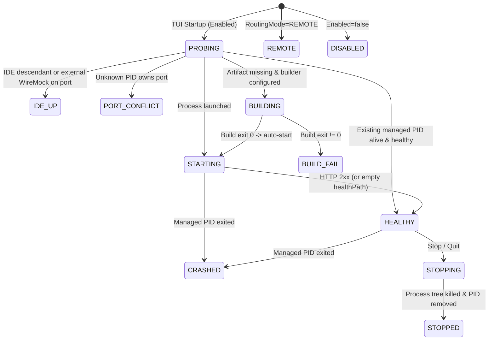

# `procomp` Portable Specification (Language-Agnostic Blueprint)

This document specifies the exact architecture, state machines, lifecycle phases, concurrency rules, WireMock protocol, log pipeline, and TUI contract of **`procomp`** so it can be ported cleanly to **pure Bash (Linux/macOS/WSL)**, **Go**, **Rust**, **Python**, or **Node** without relying on Windows- or PowerShell-specific internals.

---

## 1. Non-Negotiable Architectural Rules

1. **Rule #0 — Never Block the UI Thread:** The UI/event loop MUST NEVER spawn subprocesses (`git`, `java`, `gradlew`, `kill`), perform HTTP calls (health checks, WireMock), or run OS process/port inspections. All work runs in a background worker via asynchronous queues (`CommandJobQueue`, `GitJobQueue`) and publishes immutable snapshots to the UI.
2. **Rule #1 — Zero Hardcoded Tech Presets:** All build commands (`builders`), runtime commands (`runtimes`), and gateway commands (`gateway`) are declared declaratively in `procomp.json` using `{{var}}` templates.
3. **Rule #2 — `LOCAL`-First Priority:** Startup, port probing, health polling, and Git status checks MUST prioritize `LOCAL` / `Enabled` services before `REMOTE` / disabled ones.
4. **Rule #3 — Never Kill What You Don't Own:** Processes detected as `IDE-UP` (launched by an IDE) or externally running WireMock instances MUST NEVER be killed on `stop`, `quit`, or `down`.
5. **Rule #4 — Explicit Paths & Fail-Fast Diagnostics:** Config/JSON parse failures MUST report the full resolved file path and a content preview. Relative executables (e.g., `gradlew.bat`, `./gradlew`) MUST be resolved against the service's `WorkingDirectory`.
6. **Rule #5 — 100% `procomp.json` Compatibility:** Any port (pure Bash, Go, Rust, Python, etc.) MUST consume the exact `procomp.json` and `appsFile` (`service-index.json`) schema defined in [CONFIG_SCHEMA.md](CONFIG_SCHEMA.md) unchanged so project configs remain completely portable across implementations.

---

## 2. Service State Machine

Every service has a `RoutingMode` (`LOCAL` | `REMOTE`) and a `StatusText` from the following set:

| State | Color | Meaning |
| :--- | :--- | :--- |
| `PROBING` | Yellow | Startup/start check in progress (PID file, TCP listener, IDE tree). |
| `STOPPED` | Dim | `LOCAL` + `Enabled`, no running process or PID file. |
| `DISABLED` | Dim | `LOCAL` + `Enabled=false`, not running. |
| `REMOTE` | Dim | Routed upstream via WireMock (`remoteUrl`); never health-polled locally. |
| `BUILDING` | Yellow | Async build subprocess (`builder.command`) is currently running. |
| `BUILD-FAIL` | Red | Async build exited non-zero; preserved until next `start`/`build`/`stop`. |
| `STARTING` | Yellow | Managed process is alive; waiting for `healthPath` HTTP 2xx. |
| `HEALTHY` | Green | Managed process is alive and healthy (or `healthPath` is empty). |
| `IDE-INIT` | Yellow | Process on `localport` is an IDE descendant; health endpoint not yet 2xx. |
| `IDE-UP` | Cyan | Process on `localport` is an IDE descendant (or reused external WireMock) and healthy. |
| `PORT-CONFLICT` | Red | Non-IDE, non-managed process owns `localport`. |
| `STOPPING` | Yellow | Teardown in progress (`SIGTERM`/tree kill). |
| `CRASHED` | Red | Managed PID file exists, but OS process has exited unexpectedly. |



---

## 3. Detailed Lifecycle Phases

### Phase 1: Startup & Probing
1. **CLI / Config Load (Main Thread, fast < 100 ms):**
   - Resolve `ConfigPath`, read UTF-8 (BOM-safe) JSON, resolve `appsFile` relative to config dir (expanding `{{reposRoot}}`), merge inline `apps`, apply `defaults` (`builder`, `enabled`, `logFormat`, `proxyPathTemplate`, `remoteUrlTemplate`, `workingDir`, `vars`, `env`).
   - Derive `ProjectName` (`-Project` override > `config.project` > config filename stem > `"default"`).
   - Create project-scoped state & log directories: `.stack_state/<project>/` and `logs/<project>/`.
   - Load persisted `.stack_state/<project>/routing.json` (if present); if `-Profile <name>` was passed, apply profile and persist `routing.json`.
   - **Gateway synthesis:** If `gateway.command` and `gateway.port` (or `gateway.adminUrl`) are set and `gateway.serviceName` is not already in `apps`, synthesize a managed gateway service (`wiremock-gateway` by default, `IsGateway=true`, `Enabled=true`, `RoutingMode=LOCAL`) at index 0. Wildcard profiles (`"remote": ["*"]`) MUST keep the gateway `LOCAL` and `Enabled=true`.
2. **Immediate TUI Entry:**
   - Mark all `Enabled` services as `PROBING` (never `STOPPED` during probing).
   - Spawn `BackgroundWorker` and enqueue `{ Action = "Startup" }` on `CommandJobQueue`.
   - Enter the TUI render/input loop **immediately** so `q`, `1`–`4`, scrolling, and `PROCOMP` logs are responsive from millisecond 0.
3. **Background `Startup` Execution (Worker Thread):**
   - **Step 3a — External WireMock Pre-Check:** If `gateway.adminUrl` and `gateway.serviceName` exist, run a fast localhost TCP listener check (`< 1 ms`). If the port is listening and `GET /__admin/mappings?limit=1` returns 2xx (and no managed PID file exists for the gateway), mark the gateway `ExternalIde=true`, `Healthy=true`, `StatusText=IDE-UP`, and skip launching a duplicate copy.
   - **Step 3b — `LOCAL`-First Service Start:** Order `Enabled` services with `RoutingMode == "LOCAL"` first. For each service (skipping an externally reused gateway), call `Start-ServiceProcess -AsyncBuild`:
     1. **PID check:** Read `.stack_state/<project>/<name>.pid`. If alive → attach (`Managed=true`, `StatusText=STARTING`/`HEALTHY`) and return.
     2. **Port check:** Fast TCP listener check (`< 1 ms`). If `localport` is listening:
        - Look up owning PID and walk parent PIDs (max depth 12, cycle-safe) against known IDE process names (`idea64`, `idea`, `eclipse`, `code`, `devenv`, `studio64`).
        - If IDE ancestor found → `ExternalIde=true`, `StatusText=IDE-UP`, return.
        - Else if `IsGateway` and WireMock responds on `localport` → reuse external WireMock (`ExternalIde=true`, `Healthy=true`, `StatusText=IDE-UP`), return.
        - Else → `PortConflict=true`, `StatusText=PORT-CONFLICT`, throw error.
     3. **Artifact & Async Build check:** If `runtime.artifactGlob` is configured, locate newest matching file (excluding `artifactExclude`) in `WorkingDirectory`. If missing and `builder` is set, launch `Start-ServiceBuildAsync` (`StatusText=BUILDING`, stdout/stderr redirected to service log files) and return immediately without blocking.
     4. **Environment merge:** Merge in precedence order: global `.env` < `defaults.env` < `runtime.env` < `app.env` < `.env.<servicename>` (with `{{var}}` expansion on config env values).
     5. **Direct 1:1 launch:** Resolve relative executables against `WorkingDirectory`, spawn process directly with `stdout` → `logs/<project>/<name>.log` and `stderr` → `logs/<project>/<name>.err.log`, write PID to `.stack_state/<project>/<name>.pid`, set `StatusText=STARTING`.
     6. **Immediate publish:** Publish updated `ServiceMetrics` and increment `SnapshotVersion` immediately after *each* service so the row leaves `PROBING` right away.
   - **Step 3c — Initial WireMock Sync:** If an external WireMock was reused (or `gateway.adminUrl` has no managed `gateway.serviceName`), run `Sync-WireMockMappings` and set `GatewaySynced=true`. (If `procomp` launched `wiremock-gateway`, sync is triggered automatically once `wiremock-gateway` transitions to `HEALTHY`.)
   - **Step 3d — Deferred Async Git Scan:** Schedule the initial Git status scan for **+4 seconds** after `Startup` finishes, executed in its own non-blocking async task so `STARTING → HEALTHY` health polling is never delayed by 46+ repos.

### Phase 2: Attaching & Re-Attaching
`procomp` seamlessly attaches to three kinds of already-running processes without restarting them:
1. **Detached `procomp` Processes:** When `procomp` starts after a previous `d` (detach) or `-Action up`, `.stack_state/<project>/<name>.pid` exists and the PID is still alive. `Start-ServiceProcess` and `Refresh-ProcessSnapshot` adopt it as `Managed=true` and resume health polling and log tailing immediately.
2. **IDE-Launched Processes (`IDE-UP`):** When a developer starts a service in IntelliJ/Eclipse/VS Code on `localport` (with no `.pid` file), `Refresh-ProcessSnapshot` detects the listening port, walks the parent-PID chain, marks `ExternalIde=true`, displays `IDE-INIT` → `IDE-UP` with live PID/RAM/uptime, and refuses `stop`/`restart` requests.
3. **Externally Running WireMock:** When WireMock is already reachable on `gateway.port` (e.g., Docker or manual CLI), `procomp` reuses it (`IDE-UP`), syncs routes to it, and never kills it on exit.

### Phase 3: Detaching vs. Graceful Teardown
- **Detach (`d`):** Sets `DetachOnExit=true`, stops the background monitor runspace, restores terminal state (alt-screen off, cursor visible, mouse input disabled), and exits **leaving all managed services and active builds running**. Re-running `procomp` re-attaches via `.pid` files; `procomp -Action down` stops them later.
- **Quit (`q` / `Ctrl+C` → confirm `y`) or `-Action down`:**
  1. Stops the background monitor.
  2. For every service with `Managed=true`, active `BuildProc`, or existing `.pid` file — **and `ExternalIde=false`** — kills the entire process tree (`taskkill /F /T /PID` on Windows; `kill -TERM -$pgid` then `kill -KILL -$pgid` on POSIX) and removes `.pid`.
  3. Restores terminal state cleanly (even on unhandled exceptions via `trap`/`finally`).

### Phase 4: WireMock Instrumentation & Routing
- **Deterministic Mapping IDs:** UUID derived from `MD5("procomp:<servicename>")` so single-service updates are idempotent.
- **Mapping Schema:**
  ```json
  {
    "id": "<deterministic-uuid>",
    "name": "procomp-<servicename>",
    "priority": 5,
    "request":  { "method": "ANY", "urlPathPattern": "<proxyPath>/(.*)" },
    "response": { "proxyBaseUrl": "<http://127.0.0.1:localport | remoteUrl>", "proxyUrlPrefixToRemove": "<proxyPath>" }
  }
  ```
- **Reachability Precondition (`Test-WireMockReachable`):** For `127.0.0.1`/`localhost`/`::1`, check active TCP listeners first (`< 1 ms`); only if listening, verify `GET /__admin/mappings?limit=1` (1s timeout).
- **Full Sync (`Sync-WireMockMappings`):**
  1. Verify `Test-WireMockReachable`; if unreachable, log once and return `0`.
  2. Clear existing routes: `DELETE /__admin/mappings`.
  3. Batch-import all non-gateway service routes in **one HTTP request**: `POST /__admin/mappings/import` with `{ "mappings": [...], "duplicatePolicy": "OVERWRITE" }`.
  4. If `/import` is unsupported (older WireMock), fall back to 4-thread parallel `POST /__admin/mappings`.
  5. Guard with `GatewaySynced=true` so `Startup` and `SyncGateway` never double-sync.
- **Single-Service Toggle (`t` or click `ROUTING`):**
  1. Flip `LOCAL` ↔ `REMOTE`, persist `.stack_state/<project>/routing.json`.
  2. Send `PUT /__admin/mappings/{id}` (fallback `POST /__admin/mappings`).
- **Live WireMock Viewer (`w` / `3`):** Polled **only** while `ActiveViewMode == "WIREMOCK"`:
  - **Journal (`m`/`Tab`):** `GET /__admin/requests?limit=200` (reversed so newest is at bottom), one line per request: `HH:mm:ss.fff  METHOD /url => STATUS -> proxyBaseUrl [ms]`. (`5xx`/unmatched = `ERROR`, `4xx` = `WARN`).
  - **Mappings (`m`/`Tab`):** `GET /__admin/mappings`, one line per mapping: `METHOD pattern -> target (p=priority) [name]`.

### Phase 5: Health Polling & Async Builds
- **Health Polling (`Poll-AsyncHealth`):**
  - Never polls `REMOTE` services.
  - Never overwrites `STOPPING`, `BUILDING`, `PORT-CONFLICT`, or `BUILD-FAIL`.
  - If `healthPath` is empty, marks `Healthy=true` whenever `CachedProc` is alive.
  - Adaptive interval: **1.5s** while `STARTING` / `IDE-INIT`; **10s** once `HEALTHY` / `IDE-UP`.
  - Logs `[STATE] svc=<name> <prev> -> <next>` on every state transition.
- **Async Builds (`Start-ServiceBuildAsync`):**
  - Launches `builder.command` asynchronously with `stdout` → `logs/<project>/<name>.log` and `stderr` → `logs/<project>/<name>.err.log`.
  - Polled on every worker tick; on exit `0`, clears stale marker (`[!]`) and auto-starts the service; on non-zero exit, sets `BUILD-FAIL` and logs the last 20 lines of `stdout`/`stderr` to `procomp-trace.log`.

### Phase 6: Git Operations
- Always non-interactive (`GIT_TERMINAL_PROMPT=0`, `GIT_SSH_COMMAND="ssh -o BatchMode=yes -o ConnectTimeout=5"`), using per-process `ProcessStartInfo` env (never mutating global process env so 4-thread parallel execution is race-free).
- Deduplicated by resolved repository path; `LOCAL` repos queued first; executed across up to **4 parallel workers**.
- Periodic background `Refresh-GitSummaries` runs **4s after startup** and then every **30 minutes** inside a dedicated non-blocking async task (quiet—never hijacks the bottom ticker).
- Explicit `[f]`/`[F]` (fetch) and `[p]`/`[P]` (pull `--ff-only` on clean working trees only; dirty repos skipped safely) run via `GitJobQueue` across up to 4 threads. If new commits land on a repo, affected services are marked stale (`[!]`).

### Phase 7: Log Pipeline & Observability
- **Service `stdout` (`LogViewer`):** Incremental byte-offset reader + 1000-entry ring buffer per service. Auto-detects JSON vs. plain text, converts ISO-8601 UTC/offset timestamps to local time (`yyyy-MM-dd HH:mm:ss.fff`), folds multi-line/JSON stack traces (`[+N stack lines]`), and inherits the preceding entry's `SortKey` for timestamp-less lines so they stay chronologically anchored in `[ALL]` merged mode.
- **Service `stderr`:** Parsed via `Normalize-LogEntry` (not forced to `ERROR`). Pinned to the bottom under `--- stderr ---` **only** when `StatusText` is `BUILDING`, `BUILD-FAIL`, `CRASHED`, or `stdout` is empty; once running with `stdout` logs, placed at the top (`0000-...`) so startup `SLF4J:` / Logback lines scroll off naturally.
- **Three-Tier `procomp` Logs (in `logs/`):**
  - `procomp-error.log`: Unhandled crashes with PS/runtime version, `Action`, `Config`, `AppsFile`, message, and stack trace.
  - `procomp-debug.log`: Every external command executed (`START`, `EXEC`, `KILL`, `BUILD`, `BUILD-ASYNC`, `GIT`, `WIREMOCK`, `OPEN`).
  - `procomp-trace.log` *(default ON; disable via `-NoTrace` or `PROCOMP_TRACE=0`)*: Everything in `debug.log` plus `[CONFIG]`, `[PROFILE]`, `[ENV]` (**key names only, never secret values**), `[ARTIFACT]`, `[IDE]`, `[PORT]`, `[STATE]`, `[STEP]`, `[BUILD-DONE]`, `[SUBPROC]` (mirrored subprocess stdout/stderr), `[BG-ERROR]`, `[UI]`, and `[EXIT]`.
- **Live Ticker:** Displays `CurrentActivity` while background work is active; otherwise displays the latest banner and auto-clears transient banners to `Ready` after 6 seconds when idle (preserving error/failure/conflict banners).

---

## 4. TUI Views & Interaction Contract

Four peer full-screen/split views switchable via `1`–`4` from anywhere:

| Key | ViewMode | Purpose |
| :--- | :--- | :--- |
| `1` / `Esc` | `SERVICES` | Split view: adaptive scrollable service table (45% height cap; `SERVICE` column 21–36 chars) + bottom log preview. |
| `2` / `l` / `Enter` | `LOGS` | Full-screen service / `[a]` unified ALL log viewer with `[/]` filter, `[e]` Warn/Err, `[v]` Raw/Unified, `[z]`/click stack expand, scroll & `FOLLOW`/`PAUSED`. |
| `3` / `w` | `WIREMOCK` | Full-screen WireMock viewer (`[m]`/`Tab` toggles **Journal** vs **Mappings**, `[e]` Warn/Err, `[/]` Find). |
| `4` / `L` | `PROCOMP` | Full-screen internal `procomp` log viewer (`[v]` cycles **`INFO` → `DEBUG` → `TRACE`**, `[e]` Warn/Err, `[/]` Find). |

Terminal rendering uses the ANSI Alternate Screen Buffer (`\x1b[?1049h` / `\x1b[?1049l`), home-and-clear-to-end (`\x1b[H` + `\x1b[J`) with buffered single-write frames, tab expansion, and unified keyboard + mouse input (clickable toolbar, service rows, `ROUTING` column, stack lines, and scroll wheel).

---

## 5. Porting Matrix (Windows PowerShell ↔ Pure Bash / POSIX / Go / Rust)

| Capability | Windows PowerShell Implementation | Pure Bash / POSIX Equivalent | Go / Rust Equivalent |
| :--- | :--- | :--- | :--- |
| **JSON Parsing** | `ConvertFrom-Json` / `JavaScriptSerializer` | `jq` (or `python3 -c 'import json...'`) | `encoding/json` / `serde_json` |
| **Fast Port Check (<1ms)** | `IPGlobalProperties.GetActiveTcpListeners()` | `ss -tlnH` or `lsof -iTCP -sTCP:LISTEN -nP` | `net.DialTimeout` or `/proc/net/tcp` |
| **Port → Owning PID** | `Get-NetTCPConnection -LocalPort P -State Listen` | `ss -tlnp "sport = :P"` / `lsof -t -iTCP:P -sTCP:LISTEN` | `/proc/<pid>/fd` + `/proc/net/tcp` |
| **Parent-PID Tree Walk** | `Get-CimInstance Win32_Process` | `ps -o ppid=,comm= -p $pid` loop | `/proc/<pid>/stat` loop |
| **Process-Tree Teardown** | `taskkill.exe /F /T /PID <pid>` | Spawn with `setsid` → `kill -TERM -- -$pgid` then `-KILL` | `Setpgid: true` → `syscall.Kill(-pgid, SIGTERM/SIGKILL)` |
| **Background Worker** | `[Runspace]` + `[Hashtable]::Synchronized` | Background subshell + FIFO/temp state files | Goroutines / Tokio tasks + channels |
| **4-Thread Parallel Pool** | `[RunspacePool(1, 4)]` | `xargs -P 4` or 4-slot bash job semaphore | Worker pool (buffered channel of size 4) |
| **Non-Blocking HTTP** | `HttpClient.GetAsync()` | `curl -sS --max-time 1` in background | `net/http` / `reqwest` with timeout |
| **TUI Input (Keys+Mouse)** | Win32 `ReadConsoleInputW` | `stty -echo -icanon min 0 time 1` + ANSI SGR mouse (`\x1b[?1000;1006h`) | `tcell`/`bubbletea` / `crossterm`/`ratatui` |
| **Log Mutex** | `System.Threading.Mutex` | `flock` on lockfile | `sync.Mutex` / `std::sync::Mutex` |
